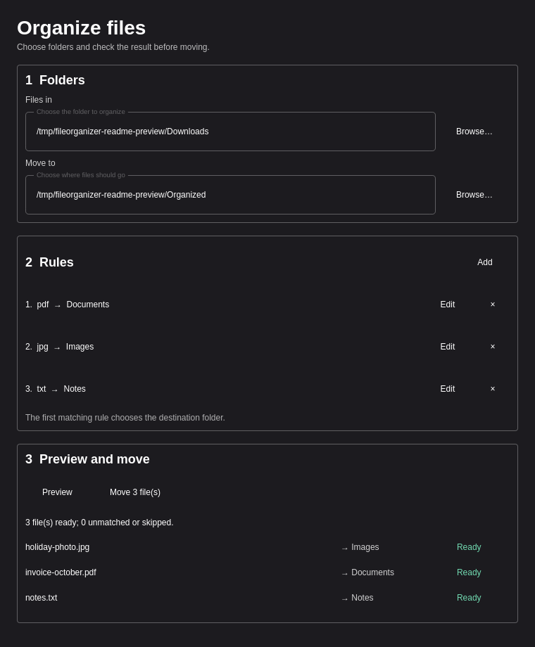

# File Organizer

File Organizer is an Omarchy bar plugin for sorting files with rules. Choose a source and destination, preview where each file will go, and move the matches from a small Qt Quick window. An optional Go daemon can watch the source folder with Linux fanotify and handle new or changed files.



*The preview uses sample files. Nothing moves until you confirm in the window or start the daemon with `--apply`.*

## What it does

- Match files by extension, exact or partial name, glob, regular expression, approximate name, MIME type, and size.
- Combine conditions within a rule. The first matching rule chooses the destination folder.
- Show matching files and name conflicts before a manual move. Existing destination files are never overwritten.
- Save rules in `~/.config/fileorganizer/profile.json` so the window and daemon use the same profile.

The organizer scans regular files directly inside the source folder. It skips hidden files, symbolic links, and subfolders. Moving across filesystems copies the file and then removes the source; if removal fails, the copy remains and the operation reports an error.

## Install on Omarchy

You need Go 1.23+, CMake, Ninja, and Qt 6.5+ with Quick and Quick Controls 2. Omarchy's plugin command installs the bar widget; the second command builds and installs the Go and Qt executables into `~/.local/bin`.

```sh
omarchy plugin add https://github.com/KitsuneForgering/FileOrganizer.git --enable --yes
make -C ~/.config/omarchy/plugins/kitsuneforgering.fileorganizer install
```

Click **Files** in the bar to open the organizer. The executables also need `~/.local/bin` on the shell's `PATH`.

To update, run `omarchy plugin update kitsuneforgering.fileorganizer --yes`, then repeat the `make -C … install` command. Omarchy updates the plugin checkout but does not rebuild external executables.

To remove it, run `make -C ~/.config/omarchy/plugins/kitsuneforgering.fileorganizer uninstall` before `omarchy plugin remove kitsuneforgering.fileorganizer --yes`. Your rules in `~/.config/fileorganizer/profile.json` remain available for a later install.

## First use

1. Choose the folder containing files and the destination folder.
2. Review the starter rules or select **Edit** to change one. Use **Other conditions** for names, regex, MIME, and size.
3. Select **Preview**. Review the destination beside each matching file.
4. Select **Move** and confirm to organize the current files.

The window saves changes as you edit. A rule needs a destination folder and at least one condition. Conditions in one rule are combined with **AND**; comma separated extensions or MIME types use **OR**.

| Condition | Example | Match |
| --- | --- | --- |
| Extensions | `pdf, docx` | Either extension |
| Name contains | `invoice` | Case insensitive substring |
| Exact name | `Report.pdf` | Full filename, case sensitive |
| Glob | `invoice-*.pdf` | Full filename pattern |
| Name regex | `^IMG_[0-9]+\.jpg$` | Go regular expression on the full filename |
| Similar name | `report.pdf`, 1 difference | Full filename within 1–3 edits |
| MIME types | `image/*, application/pdf` | Type detected from file content |
| Size | `1024` to `1048576` bytes | Inclusive range |

MIME detection reads the first 512 bytes. Container formats such as DOCX can appear as ZIP; use an extension or name rule when you need to tell them apart.

## Optional automatic mode

After saving a profile in the window, start the daemon in a terminal. Its default mode only reports what it would do, as one JSON event per line:

```sh
fileorganizer-daemon
```

Run `fileorganizer-daemon --apply` to move matching new or modified files. The daemon does not move existing files just because it starts, but a later modification can trigger a move. Stop it with Ctrl+C. It reads the profile only at startup, so restart it after changing rules. It runs in the foreground; this release does not install or enable a background service. A file reopened for further writing can produce another close event; try preview mode with your workflow before enabling automatic moves.

Use `-config /path/to/profile.json` for a different profile and `-settle 2s` to change the default 750 ms delay after an event.

## Build from source

```sh
make build
make test
make run
```

The executables are written to `build/bin/`. The window expects `fileorganizer-core` beside `fileorganizer`. The tests cover the rule engine, moves, fanotify events, and a Qt Quick smoke test. See [CHANGELOG.md](CHANGELOG.md) for version history.
